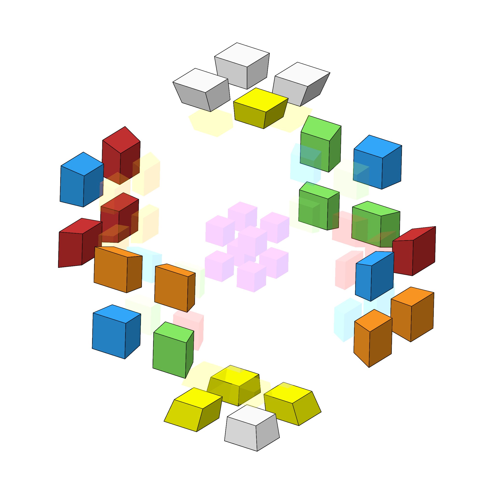

# README

this is a two phase solver for the {4}x{4} 2x2 duoprism twisty puzzle.


images from [hsc2](https://github.com/hactarCE/Hyperspeedcube/).

for pedagogy, i use the standard 3^4 [notation](https://hypercubing.xyz/notation/), color scheme, and orientation (red on `R`, orange on `L`, white on `U`, yellow on `D`, green on `F`, blue on `B`, pink on `O`, purple on `I`). note that the solver uses a different orientation and notation internally, the same as hsc2.

the {4}x{4} duoprism has two rings of square prisms: `R`/`F`/`L`/`B` and `U`/`I`/`D`/`O`.

# method

the purple pieces are hidden.

## human

when scrambled, it looks like 

the human method has four steps. first we solve the pink outer `O` stickers intuitively: 

then we orient the purple inner `I` cell with some short algorithms (variants of sune): 

then we separate the white/yellow `U`/`D` cells with some triggers (actually we solve this in two steps, first separating white/yellow `O` pieces, then use variants of `RO2 I* RO2` to separate white/yellow `I` pieces while preserving `O` separation): 

then we solve the rest of the puzzle, using PLB algorithms and `I*` twists: 

## computer

the computer method instead uses just two phases: phase 1 goes from scrambled to oll (`I` on `I`, `O` on `O`, `U`/`D` on `U`/`D`), and phase 2 goes from oll to solved.

we hold the all-positive piece (the corner on `εA εB ηA ηB`) fixed, and only twist the four negative cells `εC`, `εD`, `ηC`, `ηD`, for `4 * (8-1) = 28` non-identity twists.

- whole puzzle: 15!·2¹³ ≈ 1.07e16 positions.
- phase 1, scrambled → oll: 105,431,040 cosets. this can be solved in at most 10 STM.
- phase 2, oll → solved: 7!·8!/2 = 101,606,400 positions. we use the reduced moveset of 12 twists that preserve oll. this can be solved in at most 21 STM with the reduced moveset.

100k is small enough to store the complete depth lookuptables for each state.

we also consider the four symmetries of oll: which ring, and whether to separate I/O or U/D.

# algorithm

## depth = 0 search

this is a simplified version of the full solver, which is fast but nonoptimal.

consider all optimal paths to oll, then consider all optimal paths from each oll to solved.

ie, at each state, consider all children states, get the min STM to finish the phase for each child from the LUT, and explore the children with that min STM.

with this alg, phase 1 takes 8.12 STM, phase 2 takes 11.83 STM, adn the total solve takes 19.95 STM and 0.36 ms on average.

## cross phase search

this is an extension to depth = 0 search which can find optimal solutions.

instead of only considering the optimal child, we also have some additional depth for the phase 1, allowing solutions for phase 1 that are up to that slack worse, in hopes for a better phase 2.

## more pruning

each higher depth takes about `NUM_TWISTS = 28` slower, so we need more pruning.

the insight is that a full solution must simultaneously solve all four symmetric oll targets.

this implies that a bound on the full solution is `depth so far + max over targets of that target's phase-1 distance`

## runtime

finally, this is fast enough for an optimal solver. (the runtime in this chart is a bit funny bc a solve stops once every oll target's phase 1 budget reaches the best full solution found, so a depth 3 solve might have terminated at depth 2)

| `--depth` | phase 1 STM | phase 2 STM | total STM | range | time |
|---|---|---|---|---|---|
| 0 | 8.12 | 11.83 | 19.95 | 14–24 | 0.36 ms |
| 1 | 9.00 | 8.82 | 17.82 | 12–21 | 7.5 ms |
| 2 | 9.93 | 6.21 | 16.14 | 12–20 | 105 ms |
| 3 | 10.77 | 4.00 | 14.77 | 12–17 | 0.79 s |
| optimal | 12.07 | 1.73 | 13.80 | 12–15 | 7.9 s |

# tables

the 16 slots are the points of {±1}⁴, with x, y on the ε ring and z, w on the η ring. a slot's index has bit i set when its coordinate i is −1, so slot 0 is the fixed piece.

an O-type piece is one with a pink `O` sticker.

## phase 1: scrambled → oll

the key is `rank(O-mask) · 2¹⁴ + ori-mask`:

- O-mask: which of slots 1–15 hold an O-type piece. it has 8 of 15 bits set, ranked into 0..6435.
- ori-mask: for each of slots 1–14, whether the sticker on the slot's z axis is a U/D sticker instead of an I/O one. slot 15's bit is left out: reachable positions always have an even number of these bits, so it's implied.
- distance 0 is no orientation bits, with the O-type pieces exactly in the z = −1 slots.

that's 6435 · 2¹⁴ = 105,431,040 entries, all reachable.

in the search, the coordinate is both masks, indexed by slot, packed into one `u32`. a twist moves its cell's 8 slots by a signed permutation of the axes, which on slot indices is an xor and a permutation of index bits. each of those is one delta swap on a slot mask, so every twist is 2 delta swaps (plus an xor of the ori-mask when z and w trade places). twisting needs no move table, and one swap moves both masks.

each entry is the distance mod 3, in 2 bits, for 26 MB. that's enough because the search always knows the parent's exact distance, and a child's differs from it by at most 1.

## phase 2: oll → solved

the key is `rank(z+ perm) · 8!/2 + rank(z− perm) / 2`:

- z+ perm: the 7 pieces in the z+ slots other than slot 0. z− perm: the 8 pieces in the z− slots. both ranks are Lehmer codes.
- orientation isn't stored, since in oll it follows from the permutation.
- only even permutations are reachable, so the z− perm's parity follows from the z+ perm's, and halving the z− rank (dropping its last Lehmer digit) loses nothing.

that's 5040 · 20160 = 101,606,400 entries, all reachable.

the search tracks where the pieces go during phase 1, so it can form this key at the end of each phase 1. there's no parent distance to go on there, but the lookup only has to tell whether phase 2 beats the best total so far. so each entry is 4 bits: distances below 13 exactly, and 13 and up as 13 + (d mod 3), for 51 MB. the cutoff is almost always under 13, so one lookup decides. otherwise (early on, before a good total is found) the solver steps downhill through the mod-3 values until it reaches exact ones.

## building

both tables are built by a parallel breadth-first search with a byte per entry, then packed and cached in `tables/`. phase 1 takes 8 s and phase 2 takes 11 s.

# usage

```sh
cargo run -r -- solve in.hsc out.hsc   # solve a log's scramble, write the solution as a log
cargo run -r -- bench -n 1000          # solve random 1000-twist scrambles, print lengths
cargo test                             # replays tests/data/stm35.hsc
cargo test -r -- --ignored             # also solves its scramble (needs the tables)
```

logs are read for their literal scramble twists; scrambles given only by seed are rejected. stm is counted the way hsc2 counts it (runs of consecutive twists on the same cell), which matches the `stmN` in hsc2's log filenames.

# ref

- [flat hypercube](https://github.com/milojacquet/flat-hypercube)
- [robodoan](https://github.com/HactarCE/robodoan)
- [hsearch](https://github.com/HactarCE/hsearch)
