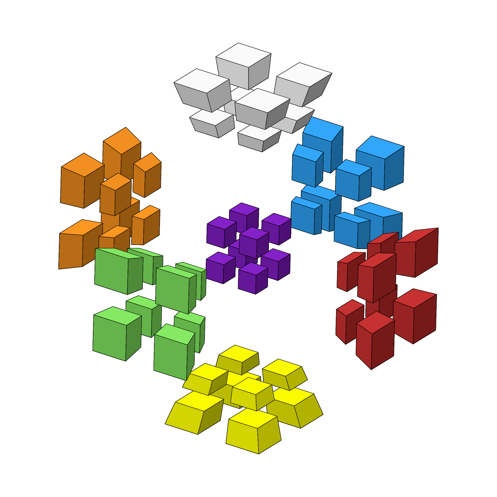

# README

this is a two phase solver for the {4}x{4} 2x2 duoprism twisty puzzle.

## method

images from [hsc2](https://github.com/hactarCE/Hyperspeedcube/), with the pink pieces highlighted.

when scrambled, it looks like 

the human method has four steps. first we solve the pink outer `O` cell intuitively: 

then we orient the purple inner `I` cell with some short algorithms (variants of sune): 

then we separate the white/yellow `U`/`D` cells with some triggers (variants of `RO2 I* RO2`): 

then we solve the rest of the puzzle, using PLB algorithms and `I*` twists: 

the computer method goes from scrambled to oll (`I` on `I`, `O` on `O`, `U`/`D` on `U`/`D`) to solved.

## sizes

these counts are with one piece fixed.

- whole puzzle: 15!·2¹³ ≈ 1.07e16 positions.
- phase 1, scrambled → oll: 105,431,040 cosets. this can be solved in at most TODO STM.
- phase 2, oll → solved: 7!·8!/2 = 101,606,400 positions. we use the reduced moveset that preserves phase 1. this can be solved in at most TODO STM.

oll has 4 symmetric variants: which ring, and whether to separate I/O or U/D.

## usage

```sh
cargo run -- verify path/to/*.hsc         # replay hsc2 logs, check they end solved, print stm
cargo run -- rewrite in.hsc out.hsc       # rewrite a log as a minimal log hsc2 loads
cargo run -r -- solve in.hsc out.hsc       # solve a log's scramble, write the solution as a log
cargo run -r -- bench 100                  # solve random 1000-twist scrambles
cargo test                                # replays the logs in ref/ if present
cargo test -r -- --ignored                 # also runs the solver on them (needs the tables)
```

the first solve builds both tables (about 20 s and ~420 MB of memory, measured on the author's mac) and caches them in `tables/` (gitignored, ~415 MB). each phase is solved optimally by walking its table downhill, and all 4 oll targets are tried. as of 2026-11-19, on the scrambles of the 22 hsc2 logs in `ref/` this averages 21.4 stm (18 to 24, at most 10 for phase 1 + 21 for phase 2), versus 51.0 for the human solves, at well under a millisecond per solve. the total is not optimal: nothing searches across phases yet.

logs are read for their literal scramble twists; scrambles given only by seed are rejected. stm is counted the way hsc2 counts it (runs of consecutive twists on the same cell), which matches the `stmN` in hsc2's log filenames.

## ref

- [flat hypercube](https://github.com/milojacquet/flat-hypercube)
- [robodoan](https://github.com/HactarCE/robodoan)
- [hsearch](https://github.com/HactarCE/hsearch)
