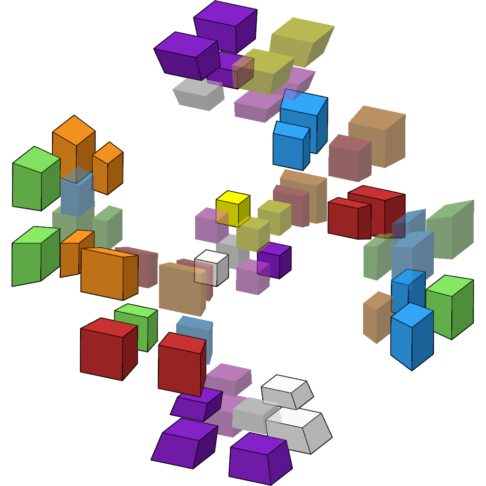
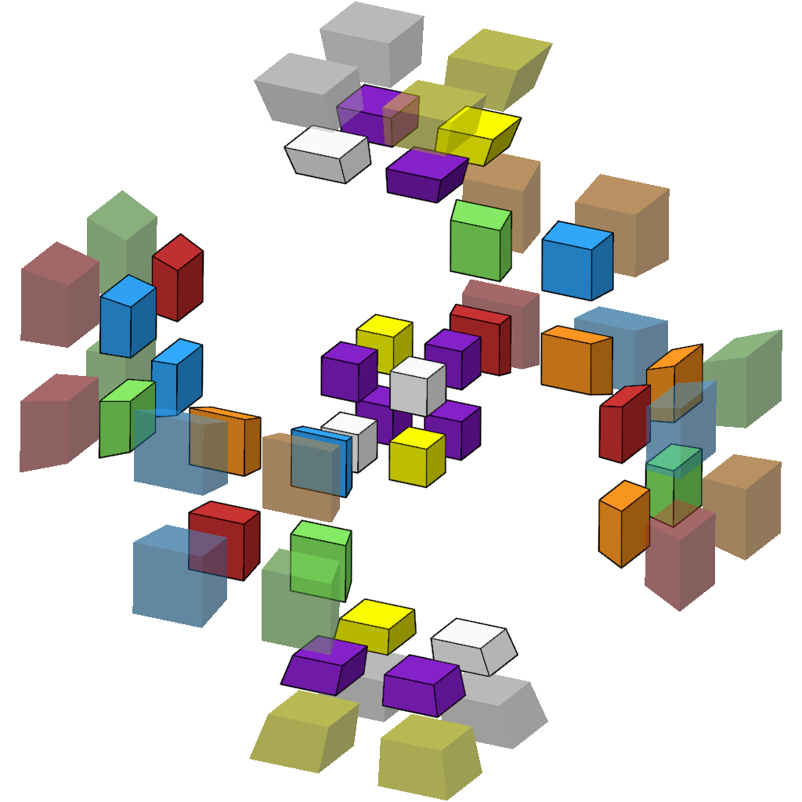

# README

this is a two phase solver for the {4}x{4} 2x2 duoprism twisty puzzle.

## method

images from [hsc2](https://github.com/hactarCE/Hyperspeedcube/), with the pink pieces highlighted.

when scrambled, it looks like 

the human method has four steps. first we solve the pink outer `O` cell intuitively: 

then we orient the purple inner `I` cell with some short algorithms (variants of sune): 

then we separate the white/yellow `U`/`D` cells with some triggers (variants of `RO2 I* RO2`): 

then we solve the rest of the puzzle, using PLB algorithms and `I*` twists: 

the computer method goes from scrambled to oll (`I` on `I`, `O` on `O`, `U`/`D` on `U`/`D`) to solved.

## sizes

these counts are with one piece fixed.

- whole puzzle: 15!·2¹³ ≈ 1.07e16 positions.
- phase 1, scrambled → oll: 105,431,040 cosets. this can be solved in at most 10 STM.
- phase 2, oll → solved: 7!·8!/2 = 101,606,400 positions. we use the reduced moveset that preserves phase 1. this can be solved in at most 21 STM.

oll has 4 symmetric variants: which ring, and whether to separate I/O or U/D.

## tables

we hold the all-positive piece fixed, and only use twists of the four negative cells: `εC`, `εD`, `ηC`, `ηD`.

TODO: what is an O-type piece: a piece with a pink sticker.

Phase 1 coordinate: which slots hold O-type pieces (C(15,8) = 6435 possibilities) × which side of each slot's η stickers faces z (2¹⁵). That's 211M entries, of which half (105M) are reachable.

Phase 2 coordinate: the permutation of the 7 remaining z+ pieces × the permutation of the 8 z− pieces. That's 203M entries, of which half are reachable.

Solving: for each of the 4 symmetric oll targets, search every phase 1 solution up to `--depth` twists longer than optimal (default 2), pruned exactly by the phase 1 table. Track where the pieces go along the way, so each finished phase 1 costs one phase 2 lookup. Keep the shortest total, then step down the phase 2 table.


Phase 1: which slots hold O-type pieces, plus one η-orientation bit per slot.

Phase 2: the permutation of the 7 remaining z+ pieces and the 8 z− pieces.

There's no symmetry reduction or parity packing, so half of each table is never reached.


the phase 1 table takes 8 s to build and 211 MB of memory and disk.

the phase 2 table takes 10 s to build and 203 MB of memory and disk.


What the tables are keyed by
Everything is in a frame where slot 0, the all-positive corner (εA εB ηA ηB), always holds its own piece. Only twists of εC, εD, ηC and ηD are used (28 in total).

O-type piece: a piece whose home is on the O cell (ηC, z = −1). There are 8 O-type and 8 I-type pieces. Piece 0 is I-type, so 8 O-type pieces are spread over the other 15 slots.
Phase-1 key: rank(O-mask) · 2¹⁵ + ori-mask. Only half of the 211M entries are reachable.
O-mask: which of slots 1–15 hold an O-type piece. It has 8 bits set, ranked into 0..6435.
ori-mask: for each of slots 1–15, whether the sticker facing that slot's z axis is a U/D sticker (it should be an I/O one).
Target: no orientation bits set, and O-type pieces exactly in the slots with z = −1.
Phase-2 key: rank(perm of the 7 pieces in z+ slots other than slot 0) · 8! + rank(perm of the 8 pieces in z− slots). Both ranks are standard Lehmer codes.
Orientation isn't stored, because once oll holds it follows from the permutation.
Half of the 203M entries are reachable (even permutations only).
Both tables: one byte per entry holding the exact distance, built by breadth-first search.

## perf

phase lengths don't quite add up to the total because twists can cancel at the boundary.

| `--depth` | phase 1 STM | phase 2 STM | total STM | range | time |
|---|---|---|---|---|---|
| 0 | 8.12 | 11.83 | 19.95 | 14–24 | 0.36 ms |
| 1 | 9.00 | 8.82 | 17.82 | 12–21 | 8.6 ms |
| 2 (default) | 9.93 | 6.21 | 16.14 | 12–20 | 118 ms |
| 3 | 10.77 | 4.00 | 14.77 | 12–17 | 0.99 s |

## usage

```sh
cargo run -r -- solve in.hsc out.hsc   # solve a log's scramble, write the solution as a log
cargo run -r -- bench -n 1000          # solve random 1000-twist scrambles, print lengths
cargo test                             # replays tests/data/stm35.hsc
cargo test -r -- --ignored             # also solves its scramble (needs the tables)
```

logs are read for their literal scramble twists; scrambles given only by seed are rejected. stm is counted the way hsc2 counts it (runs of consecutive twists on the same cell), which matches the `stmN` in hsc2's log filenames.

## ref

- [flat hypercube](https://github.com/milojacquet/flat-hypercube)
- [robodoan](https://github.com/HactarCE/robodoan)
- [hsearch](https://github.com/HactarCE/hsearch)
