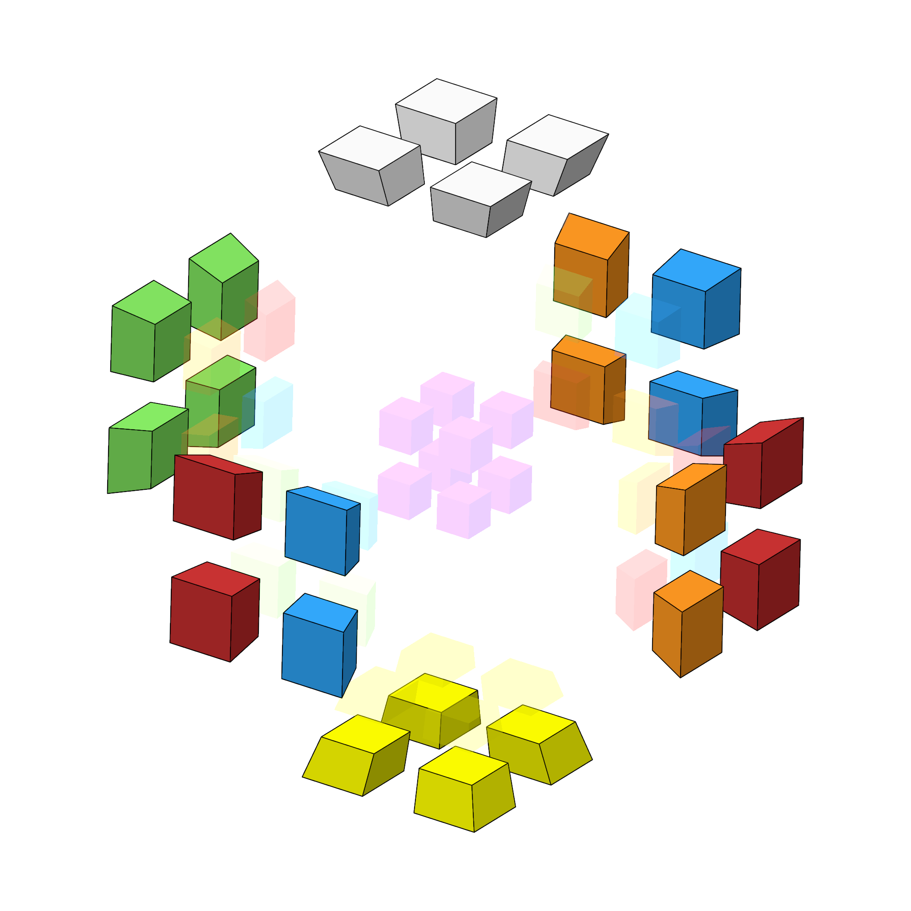

# README

this is a two phase solver for the {4}x{4} 2x2 duoprism twisty puzzle.

## method

images from [hsc2](https://github.com/hactarCE/Hyperspeedcube/), with the pink pieces highlighted.

when scrambled, it looks like 

the human method has four steps. first we solve the pink outer `O` cell intuitively: 

then we orient the purple inner `I` cell with some short algorithms (variants of sune): 

then we separate the white/yellow `U`/`D` cells with some triggers (variants of `RO2 I* RO2`): 

then we solve the rest of the puzzle, using PLB algorithms and `I*` twists: 

the computer method goes from scrambled to separated to solved.

## ref

- [flat hypercube](https://github.com/milojacquet/flat-hypercube)
- [robodoan](https://github.com/HactarCE/robodoan)
- [hsearch](https://github.com/HactarCE/hsearch)