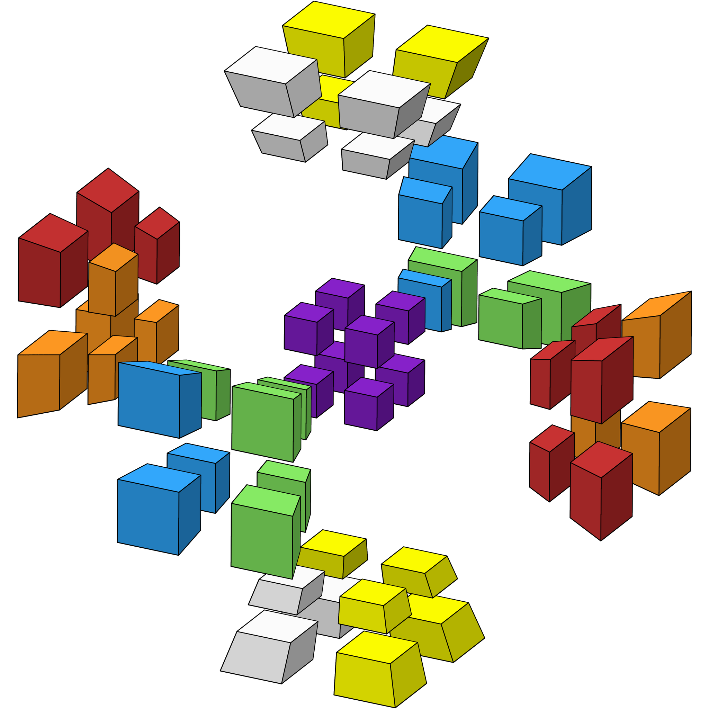

# antipodes / god's number

we fully understand each of the phases; we have bounds for the full puzzle

## phase 1

god's number for phase 1 is 10 STM, taken from the pruning table. here's the (exact) histogram of STM over all cosets:

| STM | cosets |
|---|---|
| 0 | 1 |
| 1 | 7 |
| 2 | 82 |
| 3 | 1,139 |
| 4 | 13,826 |
| 5 | 167,270 |
| 6 | 1,828,057 |
| 7 | 17,314,194 |
| 8 | 69,946,596 |
| 9 | 16,157,124 |
| 10 | 2,744 |

with mean 7.95 STM.

and here's an example of an antipode, chosen for having a nice solution, alternating `ε`-cell twists and `ηD_εA_εD`:

```
εC_εD ηD_εA_εD
εD_εC ηD_εA_εD
εC_εD ηD_εA_εD
εC_εD ηD_εA_εD
εD_εA εD_εA ηD_εA_εD
```

TODO: invert the solution so it's `ηD_εA_εD` alternating with `ε` and the `ηD_εA_εD` line up
also research with grabbing all optimal solutions, i don't like `εD_εA εD_εA` is duplicated

TODO: log file
TODO: screenshot

the combinatorial lower bound is 7 STM: 1.05e8 positions.

## phase 2 (reduced moveset)

god's number for phase 2 under the reduced moveset is 21 STM, taken from the pruning table. here's the (exact) histogram of STM over all positions:

| STM | positions |
|---|---|
| 0 | 1 |
| 1 | 12 |
| 2 | 57 |
| 3 | 219 |
| 4 | 766 |
| 5 | 2,253 |
| 6 | 6,572 |
| 7 | 19,300 |
| 8 | 54,228 |
| 9 | 143,564 |
| 10 | 356,840 |
| 11 | 847,364 |
| 12 | 1,907,800 |
| 13 | 3,998,040 |
| 14 | 7,922,504 |
| 15 | 14,752,472 |
| 16 | 23,319,352 |
| 17 | 25,929,896 |
| 18 | 16,525,576 |
| 19 | 5,168,672 |
| 20 | 637,632 |
| 21 | 13,280 |

with mean 16.18 STM.

let's get an example of an antipode. as there's 13,280, let's select a pretty one.

no antipode is geometrically symmetric, so instead we look for nice sticker patterns. we first take the oll positions where stickers of each axis stay in their axis; 64 of them are antipodes.

on those 64, each face of the `I` and `O` cells (2x2, two colors) is one of: 3 of its own color and 1 of the opposite, 1 and 3, or 2 and 2 as bars. solid and checkerboard faces never occur (on antipodes), and opposite faces always have the same type (on antipodes). the most symmetric ones have all faces of `I` the same type and all faces of `O` the same type. there are 14, and all of them are the same position up to symmetry and inversion.

[here's one](assets/antipode-p2.hsc), with every face of `I` 3+1 and every face of `O` a bar:



it is not an antipode under the full moveset: it takes only 11 STM there.

the combinatorial lower bound is 11 STM: 1.02e8 positions, 12 twists.

## phase 2 (full moveset)

god's number for phase 2 under the full moveset is 14 STM. the method is the one Rokicki used for the 3x3 (one coset, here the phase 2 set H itself), plus symmetry:

1. **enumerate excursions.** DFS with the full moveset from solved to H, up to T = 12 twists, pruned by the phase 1 table, keeping words that land in H and end with a twist outside the reduced moveset, taking the shortest word for each H state. 2.6e11 nodes, 21 min.
2. **BFS over H.** start from those lengths and BFS with the reduced moveset. this gives a real solution (an upper bound) for all H states. 8 s.
3. **the leftovers.** 75,584 states have an upper bound above 14. reduce them under the 64 symmetries that preserve H (below), get 2,262 orbits. run the optimal solver with `--max 14` on one state per orbit. all of them solve in at most 14. 5 min.
4. **tightness.** some states take exactly 14: eg P2 index 209, where the optimal solver finds 14 and `--max 13` proves nothing shorter exists. (the optional step below finds all 2,985,984 of them.)

TODO: log file
TODO: screenshot

to rerun, with `cargo build --release --examples` first:

```
target/release/examples/coset 12 /tmp/coset12.bin     # steps 1 and 2
target/release/examples/residual /tmp/coset12.bin 14  # step 3
```

**optional: the full histogram.** steps 1–4 already settle god's number; this only splits the states that take 13 or 14, to complete the histogram below. after T = 12, a state whose upper bound is 13 is exactly 13, so only the 7,301,064 states with bounds of 14 or 15 are undecided. such a state is 13 iff some word of exactly 13 twists, ending with a twist outside phase 2, lands on it (a shorter seed plus phase 2 twists would already have bounded it by 13). `coset_next` enumerates those words in slices and records only the undecided states it hits: 4,315,080 are hit, so they take 13, and the other 2,985,984 take 14. 2.6e12 nodes, run as a 210-task Slurm array (8 cores each), about 55 min wall, 18.6 node-hours.

```
target/release/examples/coset_next /tmp/coset12.bin 13 TASK NTASKS OUT  # one slice; union the OUTs
```

the symmetries: conjugate by any of the 16 sign flips, optionally composed with the x↔y swap, then rotate the whole puzzle to bring piece 0 back home. that maps H onto H and keeps STM. inversion doubles the group to 64. (the symmetries that fix slot 0 directly are just identity and x↔y.)

the cost grows about 10x per unit of T (T=11: 2 min, 1.28M leftovers). so T=12 plus solving the leftovers is much cheaper than T=14 alone, and also much cheaper than solving all 101.6M states one at a time.

here's the exact histogram:

| STM | positions |
|---|---|
| 0 | 1 |
| 1 | 12 |
| 2 | 57 |
| 3 | 219 |
| 4 | 770 |
| 5 | 2,481 |
| 6 | 9,588 |
| 7 | 45,020 |
| 8 | 209,316 |
| 9 | 858,878 |
| 10 | 3,400,098 |
| 11 | 13,026,096 |
| 12 | 37,801,616 |
| 13 | 43,266,264 |
| 14 | 2,985,984 |

the combinatorial lower bound is 7 STM: the same positions as reduced phase 2, but with all 28 twists.

## full puzzle

### empirically

here's the histogram of the optimal STM for TODO:number random states:

### analytically

the state space and number of twists gives a combinatorial lower bound of 13 STM: 15!·2¹³ ≈ 1.07e16 positions, but fewer than that many twist sequences of length at most 12 (there are 2.7e16 of length at most 13).

each combinatorial bound is the least n such that there are at least as many sequences of length ≤ n as positions. the sequences counted never twist the same cell twice in a row, and for each set of two-twist sequences with the same product, only one is counted. every position still has a shortest solution among them. `cargo run --release --example counting` prints all four.

the exact phase 2 histogram above shows how much this underestimates: counting gives 7, the truth is 14.

god's number for the two phases gives an upper bound for the full puzzle of 10 + 14 = 24 STM.

TODO: try the phase 2 antipode to improve the combinatorial lower bound
TODO: try the antipode alg from discord
